# Manual de usuario · Platos Tester

**Balanzas Hook** · Ensayo de tolva con 9 balanzas inalámbricas · Versión de la app 1.0.1

---

## Contenido

1. [Qué hace la app](#1-qué-hace-la-app)
2. [Antes de empezar](#2-antes-de-empezar)
3. [Pantalla de inicio](#3-pantalla-de-inicio)
4. [Configuración de puertos](#4-configuración-de-puertos)
5. [Calibración de un plato](#5-calibración-de-un-plato)
6. [Iniciar un ensayo](#6-iniciar-un-ensayo)
7. [Pantalla de pesaje](#7-pantalla-de-pesaje)
8. [Estático y maniobras](#8-estático-y-maniobras)
9. [Cómo leer los resultados](#9-cómo-leer-los-resultados)
10. [Salir del ensayo](#10-salir-del-ensayo)
11. [Historial de ensayos](#11-historial-de-ensayos)
12. [Exportar a Excel](#12-exportar-a-excel)
13. [Problemas frecuentes](#13-problemas-frecuentes)

---

## 1. Qué hace la app

La app mide, en una tablet Android, el peso de cada una de las **9 celdas de carga** de una tolva de 3 ejes. Cada
celda tiene su propia balanza inalámbrica (un **plato**) que manda el peso por WiFi.

```
            [1 ENGANCHE]
   [2 J1 IZQ]  JUEGO 1  [3 J1 DER]
   [4 J2 IZQ]  JUEGO 2  [5 J2 DER]
   [6 J3 IZQ]  JUEGO 3  [7 J3 DER]
   [8 J4 IZQ]  JUEGO 4  [9 J4 DER]
     LADO IZQ             LADO DER
```

- **Plato 1 · ENGANCHE**: la celda de la lanza.
- **Platos 2 a 9**: cuatro **juegos** de celdas, cada uno con una celda izquierda y una derecha (J1 = platos 2 y 3,
  J2 = 4 y 5, J3 = 6 y 7, J4 = 8 y 9).

Con la app se hace un **ensayo**: se identifica la tolva, se carga la capacidad nominal de cada celda, se toma el peso
en reposo (**estático**) y después se registran **maniobras** (marcha, giro, badén, pendiente, frenada…). En cada
maniobra la app guarda el peso **máximo** y **mínimo** que vio cada celda y avisa si alguna se acerca a su capacidad o
la supera. Los ensayos quedan guardados en la tablet y se pueden exportar a Excel.

---

## 2. Antes de empezar

1. **Encender la tablet** y activar su **punto de acceso WiFi** (hotspot). Los platos se conectan a esa red.
2. **Encender los platos.** Cada uno manda su peso a un **puerto** propio: de fábrica, el plato 1 usa el 8001, el plato 2
   el 8002, y así hasta el plato 9 con el 8009.
3. Abrir la app **Platos Tester** (así figura el ícono en la tablet). En la barra superior dice *Balanzas Hook*.

> La app funciona solo por WiFi. No usa Bluetooth.

---

## 3. Pantalla de inicio

<p align="center">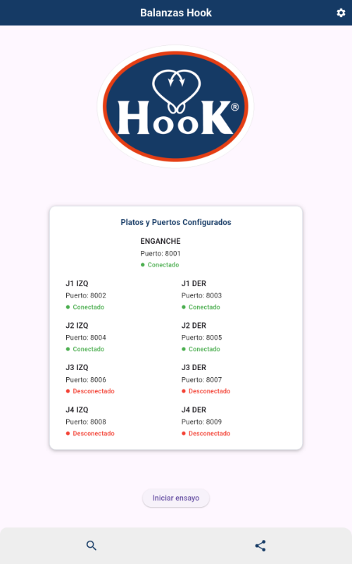</p>

La tarjeta **Platos y Puertos Configurados** muestra cada plato con su puerto y su estado:

- **Conectado** (verde): el plato está mandando datos.
- **Desconectado** (rojo): no llegó ningún dato en los últimos 5 segundos. La app sigue escuchando y lo muestra
  conectado apenas vuelve a transmitir.

Botones:

| Botón | Qué hace |
|---|---|
| ⚙ (arriba a la derecha) | Abre la configuración de puertos y la calibración de cada plato. |
| **Iniciar ensayo** | Pasa a la pantalla de inicio de ensayo. |
| 🔍 (abajo a la izquierda) | Abre el historial de ensayos. |
| Compartir (abajo a la derecha) | Genera el archivo Excel con todos los ensayos y lo comparte. |

---

## 4. Configuración de puertos

Se abre con el engranaje ⚙ de la pantalla de inicio.

<p align="center">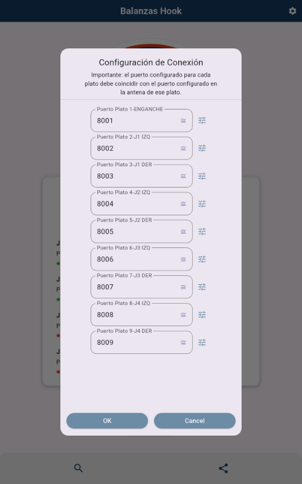</p>

- Hay un campo por plato con su puerto. **El puerto de cada plato tiene que coincidir con el que tiene configurado la
  antena de ese plato.**
- **OK** guarda los puertos y reconecta los 9 platos. **Cancel** cierra sin guardar.
- El botón que está a la derecha de cada puerto abre la **calibración** de ese plato (ver el punto 5). Al volver de la
  calibración, la configuración sigue abierta con los cambios que se hayan hecho.

---

## 5. Calibración de un plato

Permite leer y cambiar los parámetros del indicador de un plato a través del WiFi. Se abre con el botón de calibrar que
está al lado de cada puerto en la configuración.

<p align="center">
  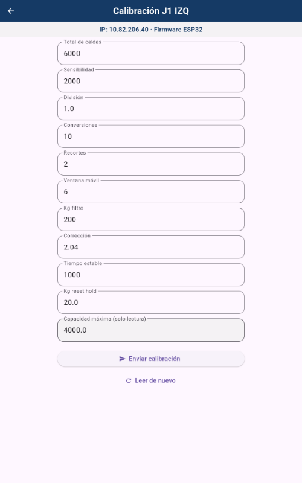
  &nbsp;
  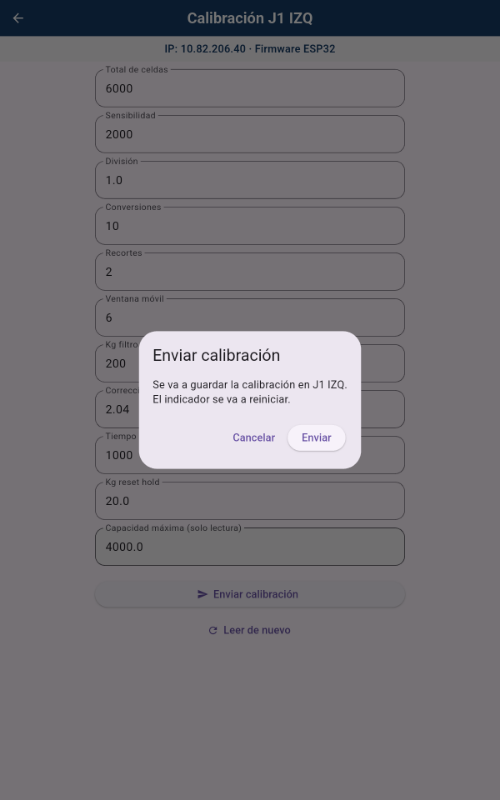
</p>

- Arriba se ven la **IP** del plato y el **tipo de firmware** (clásico o ESP32). La app lo detecta sola.
- Al abrir, la app **lee** la calibración del plato y la muestra en el formulario: total de celdas, sensibilidad,
  división, conversiones, recortes, ventana móvil, kg filtro, corrección, tiempo estable y kg reset hold. La
  **capacidad máxima** se muestra pero no se puede cambiar.
- Los valores enteros aceptan solo dígitos; los decimales aceptan coma o punto. Si un campo es inválido se marca en
  rojo y no se envía nada.
- **Enviar calibración** pide confirmación: *"Se va a guardar la calibración en … El indicador se va a reiniciar."*
  Al confirmar, la app guarda los valores en el plato, lo reinicia, avisa si salió bien y vuelve a leer.
- **Leer de nuevo** descarta lo editado y vuelve a pedir los valores al plato.

<p align="center">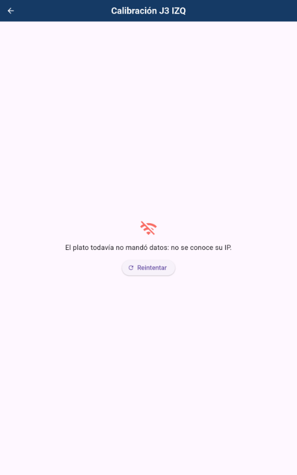</p>

Si el plato **todavía no mandó datos**, la app no conoce su IP y muestra *"El plato todavía no mandó datos: no se conoce
su IP."* Encender el plato, esperar a que figure *Conectado* y tocar **Reintentar**.

> ⚠ Cambiar la calibración modifica cómo pesa el plato. Hacerlo solo si se sabe qué valores corresponden.

---

## 6. Iniciar un ensayo

Desde la pantalla de inicio, **Iniciar ensayo**.

<p align="center">
  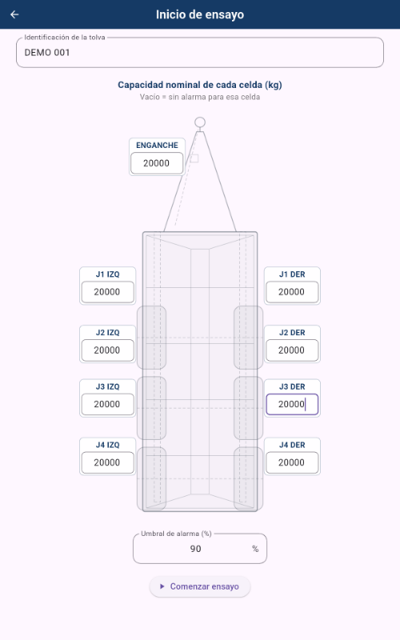
  &nbsp;
  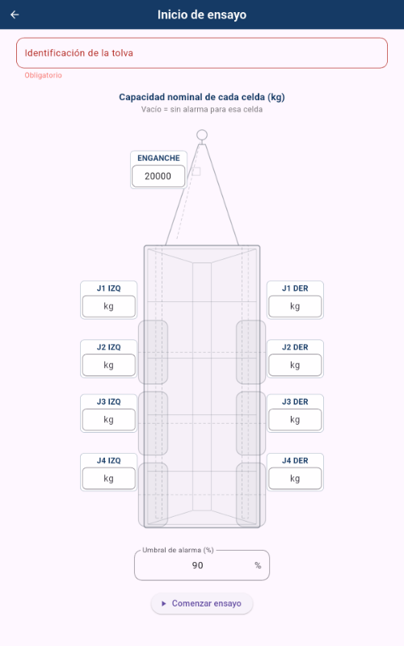
</p>

1. **Identificación de la tolva** (obligatoria): por ejemplo, el número de serie o de chasis. Si queda vacía, la app
   avisa *"Ingresá la identificación de la tolva."*
2. **Capacidad nominal de cada celda (kg)**: sobre el dibujo de la tolva (vista desde arriba, con la lanza adelante)
   hay un campo junto a cada celda. En el ejemplo se cargaron **20000 kg** en las 9. Una celda **vacía no tiene alarma**;
   la app avisa cuáles quedaron sin capacidad y deja seguir.
3. **Umbral de alarma (%)**: porcentaje de la capacidad a partir del cual una celda se marca **AL LÍMITE**. Tiene que
   ser mayor que 0 y hasta 100. Por defecto, 90 %.
4. **Comenzar ensayo**.

Las capacidades y el umbral **quedan guardados en la tablet** y aparecen cargados la próxima vez; se pueden cambiar en
cada ensayo.

---

## 7. Pantalla de pesaje

<p align="center">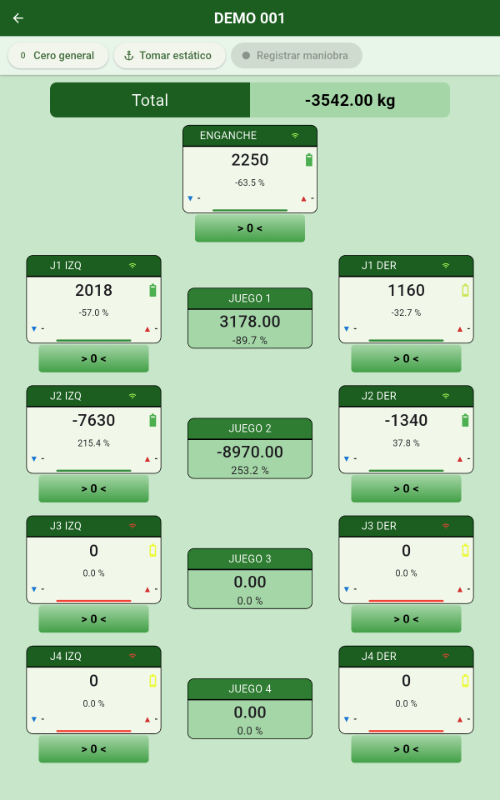</p>

En la barra superior figura la tolva del ensayo. Debajo:

- **Barra de acciones**: *Cero general*, *Tomar estático* y *Registrar maniobra* (ver el punto 8).
- **Total**: suma de los 9 platos, en kg.
- **Un recuadro por plato**, ubicado como en la tolva: el enganche arriba y los juegos de a pares, izquierda y derecha.
- **Recuadro JUEGO N** entre cada par: suma de las dos celdas del juego y su % del total.

### Recuadro de cada plato

| Elemento | Significado |
|---|---|
| Título (J1 IZQ, …) y ícono de WiFi | Nombre de la celda y estado de conexión (rojo = desconectado). |
| Número grande | Peso actual en kg. |
| % debajo del peso | Porcentaje del total que soporta esa celda. |
| Batería | Carga de la batería del plato. |
| ▼ mín (izquierda) / ▲ máx (derecha) | Mínimo y máximo de la maniobra en curso o de la última; `-` si todavía no hubo maniobras. |
| Línea de color al pie | Estabilidad del peso: **verde** estable, **rojo** en movimiento. |
| **E: …** (debajo del botón) | Peso estático tomado para esa celda. |
| Borde y título **ámbar** / **rojo** | Alarma: la celda está al límite o excede su capacidad (ver el punto 9). |

### Cero

- **`> 0 <`** debajo de cada plato: pone a cero ese plato. Avisa *"Cero enviado a … Volvé a tomar el estático."*
- **Cero general**: manda el cero a los 9 platos, uno por uno, y avisa cuáles fallaron, si alguno falla.
- **Cualquier cero borra el estático**, porque deja de valer: hay que volver a tomarlo.
- Durante una maniobra los ceros están deshabilitados.

---

## 8. Estático y maniobras

El flujo de trabajo es siempre: **tomar estático → registrar maniobra → terminar maniobra**, y repetir las maniobras las
veces que haga falta.

### 8.1 Tomar estático

Con la tolva **parada**, tocar **Tomar estático**. La app guarda el peso actual de cada celda como referencia (la línea
**E:** debajo de cada plato) y avisa *"Estático tomado."* El estático vale para todas las maniobras siguientes, hasta que
se vuelva a tomar o se haga un cero.

<p align="center">
  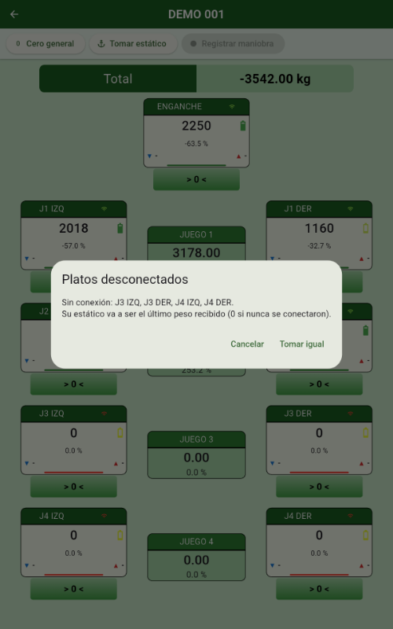
  &nbsp;
  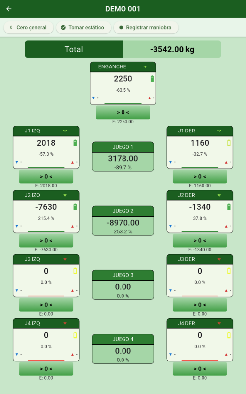
</p>

Si hay platos desconectados, la app lo avisa antes: su estático va a ser el último peso recibido (0 si nunca se
conectaron). **Tomar igual** sigue; **Cancelar** permite revisar la conexión primero.

### 8.2 Registrar una maniobra

**Registrar maniobra** se habilita solo con el estático tomado. Al tocarlo:

- la barra muestra **Maniobra N** y el cronómetro, y el botón pasa a **Terminar maniobra** (rojo);
- cada plato muestra en vivo su **▼ mínimo** y **▲ máximo**: la app compara **todos** los pesos que llegan, no solo los
  que se ven en pantalla;
- *Cero general*, *Tomar estático* y los `> 0 <` quedan deshabilitados;
- la pantalla de la tablet **no se apaga** mientras dura la maniobra.

<p align="center">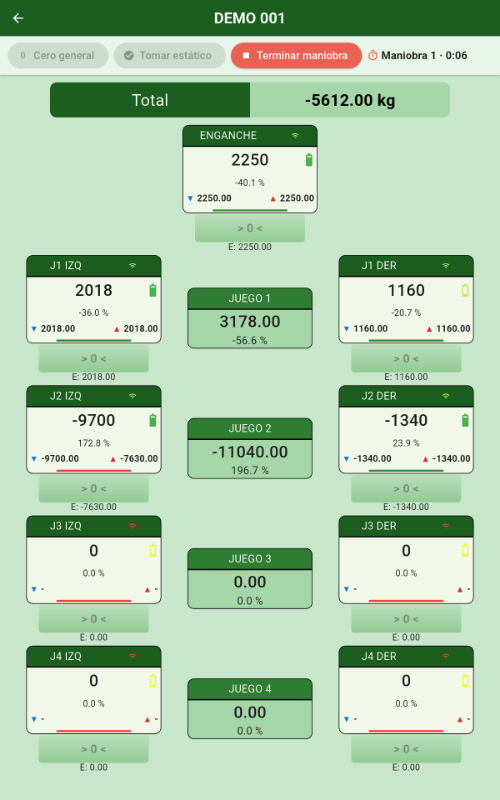</p>

### 8.3 Terminar la maniobra

**Terminar maniobra** guarda la maniobra (avisa *"Maniobra N guardada."*) y muestra la tabla de resultados:

<p align="center">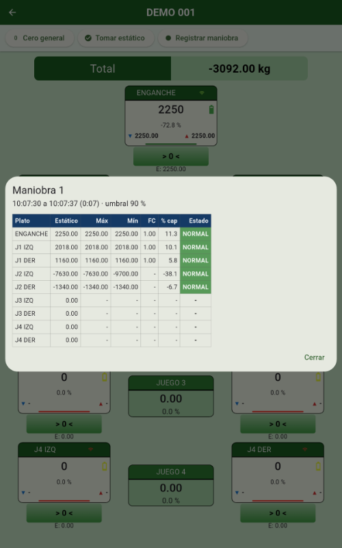</p>

En la cabecera figuran la hora de inicio y fin, la duración y el umbral usado. Las maniobras se numeran solas dentro del
ensayo (1, 2, 3…). Después de cerrar la tabla se puede registrar la siguiente maniobra con el mismo estático.

---

## 9. Cómo leer los resultados

Cada fila de la tabla es una celda:

| Columna | Qué es |
|---|---|
| **Estático** | Peso en reposo tomado antes de la maniobra. |
| **Máx / Mín** | Mayor y menor peso que llegó durante la maniobra. |
| **FC** (factor de cresta) | Máx ÷ estático. Cuántas veces se multiplicó la carga. `-` si el estático es 0 o negativo. |
| **% cap** | Máx × 100 ÷ capacidad nominal. `-` si la celda no tiene capacidad. |
| **Estado** | Ver la tabla siguiente. |

| Estado | Cuándo |
|---|---|
| **NORMAL** (verde) | % cap por debajo del umbral. |
| **AL LÍMITE** (ámbar) | % cap igual o mayor que el umbral, hasta 100 %. |
| **EXCEDE** (rojo) | % cap mayor que 100 %. |
| `-` | La celda no tiene capacidad cargada o no recibió datos. |

**Ejemplo:** una celda con estático 2410 kg, máximo 5980 kg y capacidad 5000 kg da FC 2,48, 119,6 % y **EXCEDE**.

### Alarma en vivo

Durante el ensayo, el recuadro de cada plato cambia de color con el mismo criterio: **ámbar** si está al límite y
**rojo** si excede. Mientras corre una maniobra se compara el **máximo** de la maniobra; fuera de ella, el peso actual.

En este ejemplo (ensayo *DEMO 002*) se cargaron capacidades chicas a propósito: el enganche (2400 kg) y J1 DER
(1200 kg) quedan al límite y J1 IZQ (2000 kg) excede.

<p align="center">
  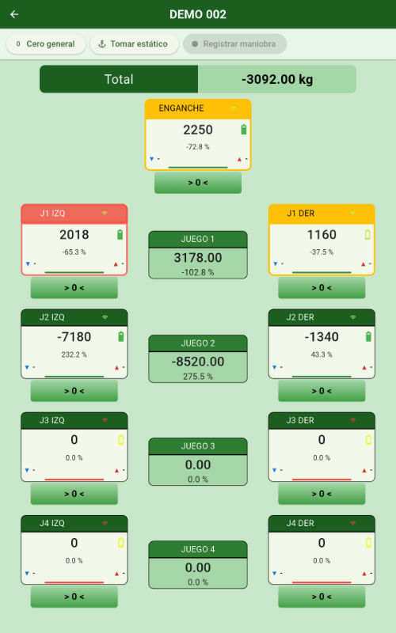
  &nbsp;
  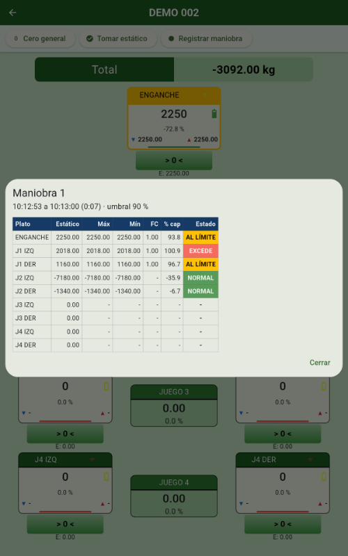
</p>

---

## 10. Salir del ensayo

La flecha atrás (o el botón atrás de la tablet) **siempre pide confirmación**. El mensaje explica qué pasa en cada caso:

<p align="center">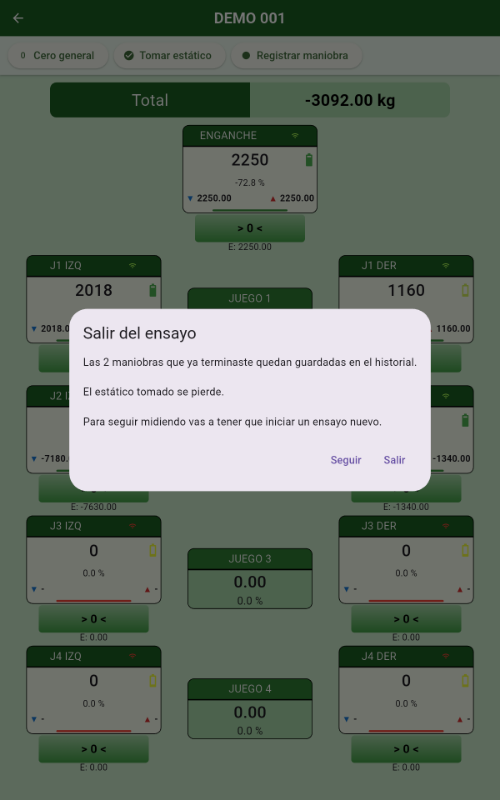</p>

- Las maniobras **terminadas** quedan guardadas en el historial.
- Si **no se registró ninguna maniobra**, el ensayo no se guarda.
- Si hay una **maniobra en curso**, se descarta (botón *Descartar y salir*).
- El estático tomado se pierde: para seguir midiendo hay que iniciar un ensayo nuevo.

**Seguir** vuelve a la pantalla de pesaje sin perder nada.

---

## 11. Historial de ensayos

Desde la pantalla de inicio, el botón 🔍 de abajo a la izquierda.

<p align="center">
  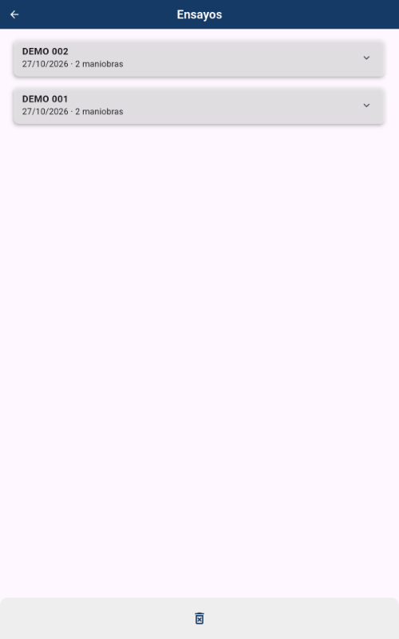
  &nbsp;
  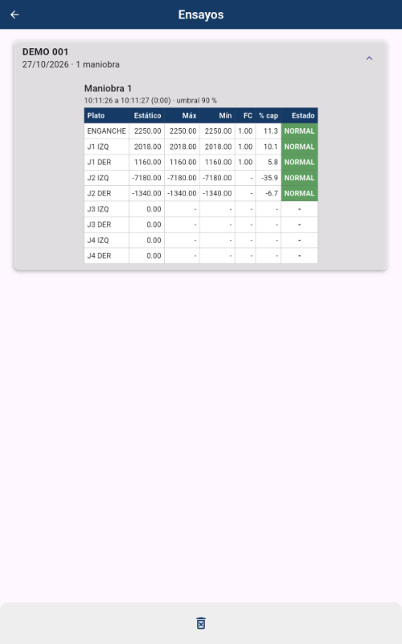
</p>

- Cada tarjeta muestra la tolva, la fecha y la cantidad de maniobras. Los más nuevos están arriba.
- Tocar una tarjeta la **expande** y muestra la tabla de cada maniobra, igual que al terminarla.

### Borrar

<p align="center">
  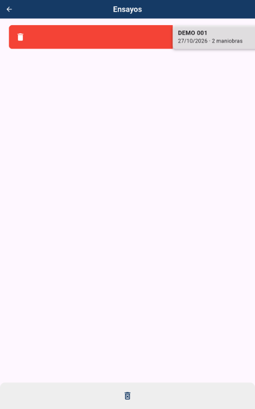
  &nbsp;
  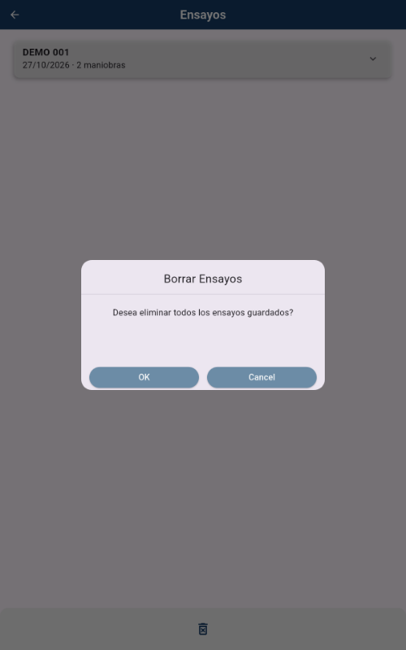
</p>

- **Un ensayo**: deslizar la tarjeta hacia la derecha. Aparece el aviso *"Se eliminara el ensayo …"* con **OK** y
  **cancel**. **cancel** lo recupera; **OK**, o dejar pasar **5 segundos**, lo borra definitivamente.
- **Todos**: el botón de la papelera de abajo pide confirmación (*"Desea eliminar todos los ensayos guardados?"*).

> ⚠ Lo borrado no se puede recuperar. Si hace falta conservarlo, exportarlo antes (punto 12).

---

## 12. Exportar a Excel

El botón **compartir** (abajo a la derecha de la pantalla de inicio) genera el archivo **ensayos.xlsx** con **todos**
los ensayos guardados y abre el menú de Android para mandarlo (correo, Drive, WhatsApp, Bluetooth, etc.).

<p align="center">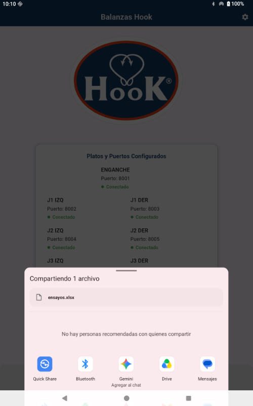</p>

El archivo tiene una hoja **maniobras** con **una fila por maniobra y por celda**, de los ensayos más viejos a los más
nuevos. Columnas:

| Columna | Contenido |
|---|---|
| `ensayo_id`, `tolva`, `fecha` | Identificación del ensayo. |
| `maniobra`, `hora_inicio`, `hora_fin`, `duracion_s` | Número y horario de la maniobra (duración en segundos). |
| `plato`, `nombre` | Número de plato (1 a 9) y nombre de la celda. |
| `capacidad` | Capacidad nominal usada. |
| `estatico`, `maximo`, `minimo` | Pesos en kg. |
| `lecturas` | Cantidad de pesos que llegaron del plato durante la maniobra. |
| `factor_cresta`, `por_cap`, `estado` | Los mismos cálculos de la tabla (punto 9). |

Si no hay maniobras guardadas, la app avisa *"No hay maniobras guardadas para exportar."* y no comparte nada.

---

## 13. Problemas frecuentes

| Problema | Qué revisar |
|---|---|
| Un plato figura **Desconectado** | Que esté encendido y con batería, que esté conectado al WiFi de la tablet y que su puerto en la configuración coincida con el de su antena. |
| La calibración dice que **no se conoce la IP** | El plato todavía no mandó datos. Esperar a que figure *Conectado* y tocar **Reintentar**. |
| **No se pudo leer la calibración** | Que el plato siga conectado; tocar **Leer de nuevo**. |
| **No se pudo enviar cero a …** | El plato no respondió (apagado, fuera de alcance o sin IP conocida). Revisar la conexión y repetir. |
| **Registrar maniobra** está gris | Falta tomar el estático (o se borró por un cero). |
| **Tomar estático** avisa platos desconectados | Revisar esos platos; si igual se toma, su estático queda en el último peso recibido. |
| Los máximos parecen bajos | La app solo ve los pesos que llegan por WiFi. Comparar `lecturas` con la duración en el Excel: pocas lecturas por segundo pueden perder picos cortos. |
| Se borró el estático | Cualquier cero lo borra. Volver a tomarlo con la tolva quieta. |
